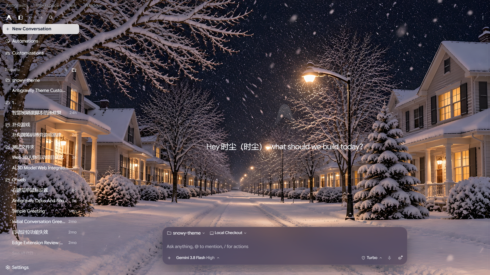
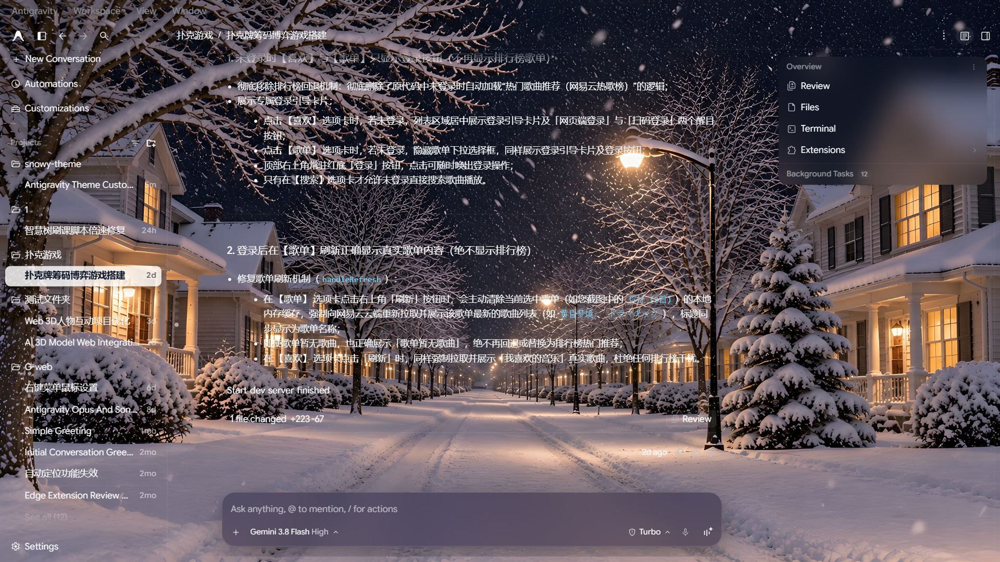
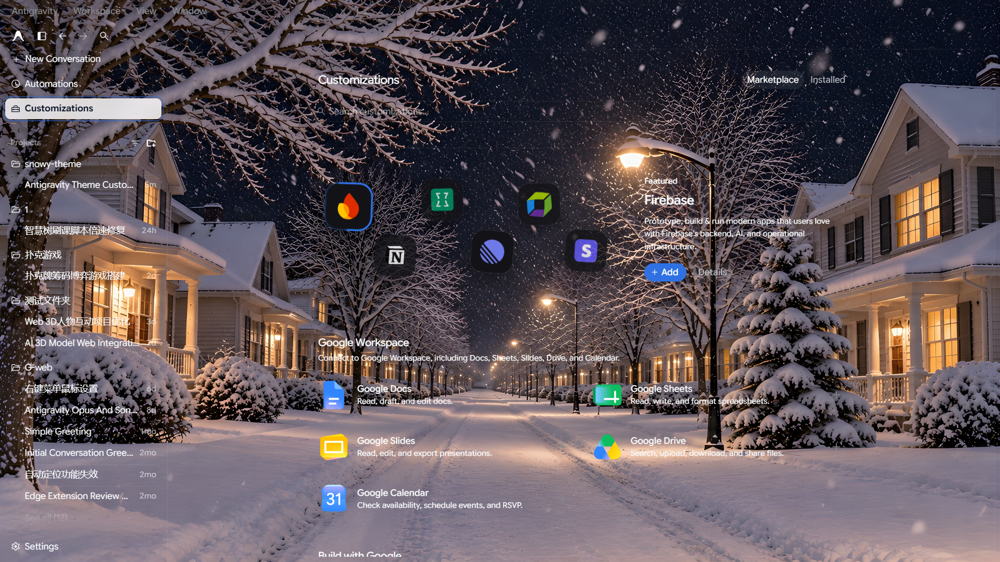
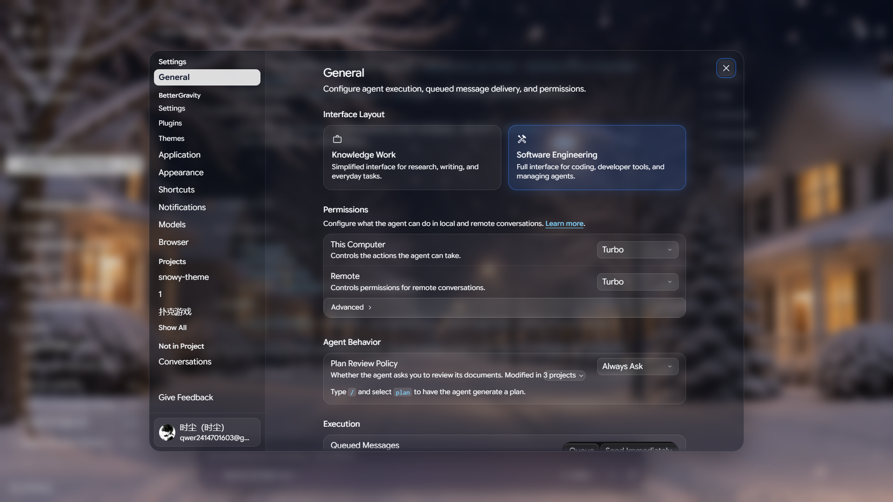

# Dark Snowy Night Theme (极简清透雪夜主题)

专为 **Antigravity** 与 **BetterGravity** 倾力打造的极简清透毛玻璃雪夜壁纸主题。

---

## 📸 主题预览 (Screenshots)

### 1. 主工作区与新对话 (Main Workspace & Overview)


### 2. 对话交流与消息界面 (Conversation View)


### 3. 插件与自定义市场 (Customizations & Plugins)


### 4. 设置面板毛玻璃质感 (Frosted Glass Settings Modal)


---

## ✨ 特性亮点 (Features)

- ❄️ **沉浸式雪夜壁纸**：在最底层固定挂载 2K 高清雪夜街景壁纸，全透明顶栏与侧边栏无缝融入桌面与雪夜背景。
- 🔮 **通透高级毛玻璃界面**：
  - **底部主输入框（Composer）**：半透明毛玻璃大胶囊质感（`backdrop-filter: blur(28px) saturate(180%)`），去除突兀多余白框，小药丸选项无缝融入大框。
  - **设置面板（Settings Modal）**：彻底清除 Tailwind 默认的 `rgb(7, 7, 8)` 死黑实色遮罩，蜕变为与输入框一致的清透毛玻璃大框，背景暖黄街灯与雪景柔和折射透出。
  - **上下文菜单与弹窗**：模型选择、Turbo 权限、轻量确认弹窗全面毛玻璃化，半透防遮挡。
- 🎯 **精致交互与智能选中态**：
  - **未选中态**：文字与图标保持清晰纯白（`#f8fafc`），底色全透明无多余色块遮挡；
  - **动态选中高亮**：无论是开启新对话（`+ New Conversation`）还是历史对话项，光标与选择停留在哪，即自动呈现非常浅的白色半透明毛玻璃底板（`rgba(255, 255, 255, 0.82)`），文字与图标自动反转为高对比度深黑字（`#0f172a`），优雅醒目。
- 🛡️ **侧边栏操作三键智能防冲淡适配**：
  - **选中的对话行**：三个操作键（停止/归档、固定、更多 ⋮）配以浅白半透微胶囊底板，图标自动匹配为**高对比度纯黑（`#0f172a`）**，彻底告别白底白标看不清的问题；
  - **未选中的对话行**：三个操作键封装为**深色半透明毛玻璃独立小胶囊**（`rgba(18, 24, 36, 0.78)`），图标保持**纯白（`#ffffff`）**，即使悬浮在亮色雪景或明亮温暖的窗户灯光前，也清晰坚挺、绝不冲淡；
  - **智能渐隐防撞车**：长对话标题右侧增加自然渐隐遮罩，长文本平滑淡出，绝不与右侧操作按钮重叠挤撞。
- 🛑 **核心组件与细节修复**：
  - 精确保护并高亮输入框右下角鲜明的红色暂停/取消方块（Cancel `Ctrl+D`）；
  - 仅代码、函数名、行内参数代码（如 `rgba(...)`）使用清透冰蓝（`#7dd3fc`）高亮，中文正文与说明保持柔和纯白，阅读更舒适。

---

## 📦 目录结构 (Structure)

```text
snowy-theme/
├── screenshots/     # 4 张高清主题效果实测截图
│   ├── 1.png        # 主工作区与新对话
│   ├── 2.png        # 对话交互与消息详情
│   ├── 3.png        # 插件与自定义市场
│   └── 4.png        # 设置面板高级毛玻璃
├── background.png   # 2K 高清雪夜街景壁纸
├── theme.css        # 主题核心样式表（含 BetterGravity 主题元信息）
└── README.md        # 主题介绍、效果预览与安装使用指南
```

---

## 🚀 安装与使用 (Installation)

### 配合 BetterGravity 使用
1. 确保已安装并配置好 **BetterGravity** 框架；
2. 将本主题文件夹 `snowy-theme` 复制放置于 BetterGravity 的主题目录下：
   - **Windows 路径**：`%APPDATA%\BetterGravity\themes\snowy-theme`
   - （即 `C:\Users\<你的用户名>\AppData\Roaming\BetterGravity\themes\snowy-theme`）
3. 重启或在 BetterGravity / Antigravity 设置中勾选激活 **Dark Snowy Night Theme** 即可立即生效。

---

## 📝 主题元数据 (Metadata)

- **主题名称**：Dark Snowy Night Theme
- **作者**：时尘
- **当前版本**：v3.7.0
- **适用平台**：Antigravity (with BetterGravity)
